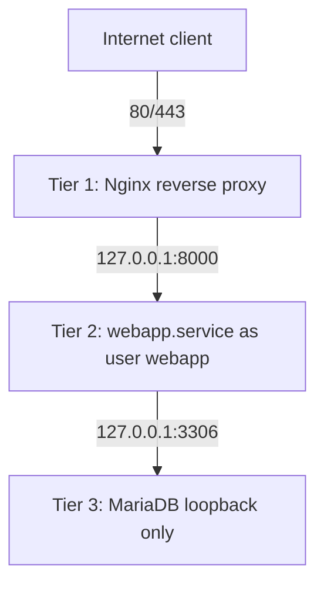

# Team-Project-Milestone-Sistem-Operasi-TIKAB-2026
README outline
1. Title, one-paragraph summary, team table (name, role, files).
2. Architecture diagram (this renders on GitHub):

3. Prerequisites (clean Ubuntu/Rocky VM, sudo, internet).
4. Quick start: git clone , cp env.example .env , edit .env , ./deploy.sh , bash
tests/health_check.sh .
5. Configuration table (variables) and design decisions ( Wants vs Requires , set -E ,
why install -d , why envsubst with a variable list).
6. Test evidence: two-run output, systemd-analyze security score, kill -9 result,
shellcheck result.
7. Troubleshooting (SELinux boolean, Nginx default site, firewall).
8. Contribution log per member.
.gitignore minimum: .env , deploy.log .
