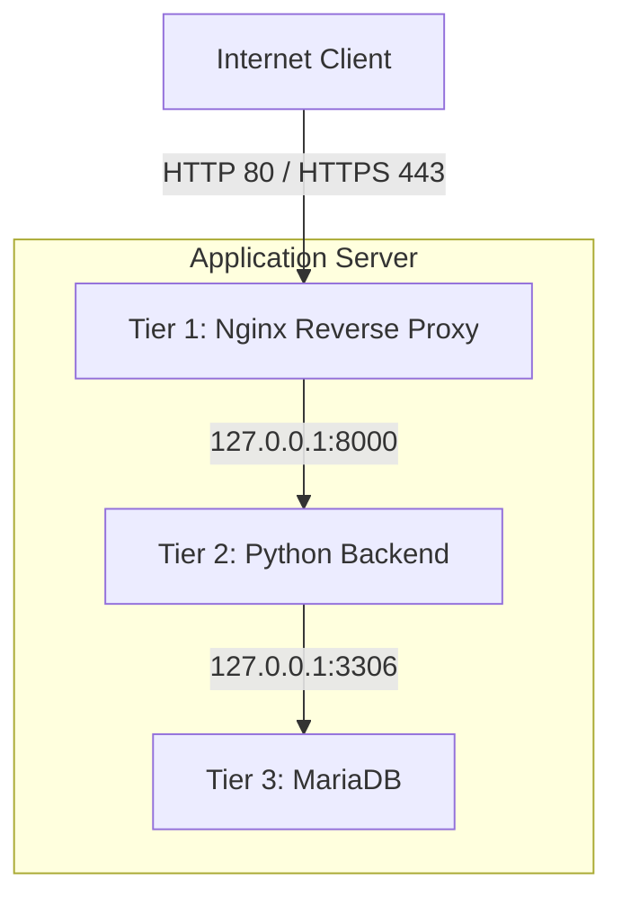

# Team Project Milestone – Sistem Operasi TIKAB 2026

## 1. Project Overview

This project implements an automated, multi-tier web application deployment system for the Operating Systems Practicum (Milestone 2 – UK5). The deployment is orchestrated through a single Bash script, `deploy.sh`, which provisions system users, installs dependencies, configures MariaDB, applies security settings, deploys a Python backend as a systemd service, and configures Nginx as a reverse proxy.

The system is designed to support Ubuntu/Debian and Rocky/AlmaLinux environments, with an emphasis on security, automation, error handling, and idempotency. Running the deployment script multiple times should produce the same final configuration without unnecessary changes or errors.

### Team Members

| No. | Name | Role | Responsibilities / Files |
|---|---|---|---|
| 1 | [Marlen Edzel Satriani] | Integrator & Master Installer | `deploy.sh`, integration, Git branches and merges |
| 2 | [Kinza Alham Jawda Murtaza] | Provisioning & Dependencies | `scripts/01_setup_users.sh`, `scripts/02_install_deps.sh`, `env.example`, `configs/database.cnf` |
| 3 | [Hafiz Naufal Pramudya Susanto] | Systemd & Nginx Gateway | `systemd/webapp.service`, `configs/nginx.conf.template`, `app/app.py`, `scripts/04_deploy_services.sh` |
| 4 | [Excel Adhiraja Subrian] | Security, Documentation & QA | `scripts/03_configure_sec.sh`, `tests/health_check.sh`, `README.md`, `.gitignore` |

---

## 2. System Architecture

The project uses a three-tier architecture consisting of an Nginx reverse proxy, a Python backend managed by systemd, and a MariaDB database.



### Architecture Components

| Tier | Component | Description |
|---|---|---|
| Tier 1 | Nginx | Receives HTTP requests and forwards them to the Python backend. |
| Tier 2 | Python Backend | Runs as `webapp.service` under the dedicated `webapp` system user. |
| Tier 3 | MariaDB | Stores application data and only listens on the local loopback interface. |

### Request Flow

1. A client sends an HTTP request to the server on port `80`.
2. Nginx receives the request and forwards it to `127.0.0.1:8000`.
3. The Python backend processes the request.
4. The backend checks database connectivity through `127.0.0.1:3306`.
5. The response is returned to Nginx and forwarded to the client.

The backend is intentionally bound to `127.0.0.1`, preventing direct external access to the application port.

---

## 3. Repository Structure

```text
project-root/
├── README.md
├── deploy.sh
├── env.example
├── .gitignore
│
├── app/
│   └── app.py
│
├── systemd/
│   └── webapp.service
│
├── configs/
│   ├── nginx.conf.template
│   └── database.cnf
│
├── scripts/
│   ├── 01_setup_users.sh
│   ├── 02_install_deps.sh
│   ├── 03_configure_sec.sh
│   └── 04_deploy_services.sh
│
└── tests/
    └── health_check.sh
```

### Deployment Execution Order

The main deployment script executes the following components sequentially:

```text
deploy.sh
    |
    ├── 01_setup_users.sh
    |
    ├── 02_install_deps.sh
    |
    ├── 03_configure_sec.sh
    |
    ├── 04_deploy_services.sh
    |
    └── tests/health_check.sh
```

---

## 4. Prerequisites

Before deploying the application, ensure the following requirements are met:

- Ubuntu/Debian or Rocky/AlmaLinux virtual machine.
- Root access or a user with passwordless sudo privileges.
- Active internet connection.
- Git installed.
- Access to the project repository.

### Required Dependencies

The deployment script automatically installs the required packages.

| Package | Purpose |
|---|---|
| Nginx | Reverse proxy |
| MariaDB Server | Database management |
| Python 3 | Backend application runtime |
| gettext / gettext-base | Provides `envsubst` for configuration rendering |
| curl | HTTP health checks |

---

## 5. Installation and Quick Start

### Step 1. Clone the Repository

```bash
git clone <repository-url>
cd <repository-directory>
```

### Step 2. Create the Environment File

Copy the example configuration:

```bash
cp env.example .env
```

### Step 3. Configure Environment Variables

Edit the `.env` file:

```bash
nano .env
```

Example configuration:

```env
DB_NAME=webapp_db
DB_USER=webapp_user
DB_PASS=change_me_to_a_long_random_password
APP_PORT=8000
DOMAIN_NAME=_
```

Replace the example database password with a strong password.

**Important:** The `.env` file contains sensitive credentials and must never be committed to Git.

### Step 4. Execute Deployment

Run the deployment script:

```bash
chmod +x deploy.sh
./deploy.sh
```

The script automatically:

1. Checks system requirements.
2. Loads environment variables.
3. Creates the application system user and directories.
4. Installs required dependencies.
5. Configures MariaDB and creates the application database.
6. Configures firewall and security settings.
7. Deploys the Python backend.
8. Installs and starts the systemd service.
9. Configures and reloads Nginx.
10. Runs the health check script.

### Step 5. Verify Deployment

Run the health check manually:

```bash
bash tests/health_check.sh
```

Expected result: all checks display `[PASS]`, with zero failures.

Access the application:

```text
http://localhost/
```

Health endpoint:

```text
http://localhost/health
```

---

## 6. Configuration

### 6.1 Environment Variables

All application configuration is loaded from `.env`.

| Variable | Example | Description | Requirement |
|---|---|---|---|
| `DB_NAME` | `webapp_db` | MariaDB database name | Required |
| `DB_USER` | `webapp_user` | Database username | Required |
| `DB_PASS` | Secret | Database password | Required |
| `APP_PORT` | `8000` | Backend listening port | Optional, default `8000` |
| `DOMAIN_NAME` | `_` | Nginx server name | Optional, default `_` |

### 6.2 Important System Paths

| Path | Purpose |
|---|---|
| `/var/www/webapp` | Application directory |
| `/var/www/webapp/data` | Application data directory |
| `/var/log/webapp` | Application log directory |
| `/etc/webapp/webapp.env` | systemd environment configuration |
| `/etc/systemd/system/webapp.service` | systemd service unit |
| `/etc/nginx/conf.d/webapp.conf` | Generated Nginx configuration |
| `/etc/mysql/mariadb.conf.d/99-hardening.cnf` | MariaDB configuration on Debian/Ubuntu |
| `/etc/my.cnf.d/99-hardening.cnf` | MariaDB configuration on Rocky/AlmaLinux |

### 6.3 Technical Design Decisions

#### A. `Wants=` vs. `Requires=` in systemd

The systemd service uses:

```ini
After=network.target mariadb.service
Wants=mariadb.service
```

`Wants=` creates a weak dependency. systemd attempts to start MariaDB alongside the application, but the application is not automatically prevented from starting if MariaDB fails.

`Requires=` creates a stronger dependency. If the required service fails to start, the dependent service is affected.

We use `Wants=` to allow the application service to start independently of MariaDB startup success. Database connectivity is checked separately by the application.

#### B. Using `set -E` in Bash

The deployment script uses:

```bash
set -Eeuo pipefail
```

The `-E` option enables ERR trap inheritance in shell functions and other applicable execution contexts.

This allows the error handler to provide useful error messages when a command fails inside a function.

Other options:

- `-e`: Exit when an unhandled command failure occurs.
- `-u`: Treat unset variables as errors.
- `-o pipefail`: Return a failure if a command in a pipeline fails.

#### C. Using `install -d`

Instead of using separate `mkdir`, `chown`, and `chmod` commands, the deployment scripts use:

```bash
sudo install -d -o webapp -g webapp -m 0750 \
    /var/www/webapp \
    /var/www/webapp/data \
    /var/log/webapp
```

`install -d` creates directories while setting their ownership and permissions.

This simplifies provisioning and makes directory configuration repeatable.

#### D. Using `envsubst` with an Explicit Variable List

Nginx configuration contains variables such as `$host`, `$remote_addr`, and `$scheme`.

Using unrestricted `envsubst` could accidentally replace these Nginx variables.

Instead, the deployment script uses:

```bash
envsubst '${APP_PORT} ${DOMAIN_NAME}' \
    < configs/nginx.conf.template \
    > /tmp/webapp-nginx.conf
```

Only `APP_PORT` and `DOMAIN_NAME` are substituted. Nginx-specific variables remain unchanged.

---

## 7. Security Implementation

The project applies multiple security measures to protect the application and its services.

### 7.1 Dedicated System User

The application runs using a dedicated system account:

```text
User: webapp
Group: webapp
Shell: /sbin/nologin
```

This prevents the application from running as root and restricts interactive login.

### 7.2 MariaDB Loopback Binding

The MariaDB configuration:

```ini
[mysqld]
bind-address = 127.0.0.1
skip-name-resolve
local-infile = 0
```

This ensures MariaDB only accepts network connections through the local loopback interface.

Port `3306` is intentionally not exposed through the firewall.

### 7.3 systemd Sandboxing

The application service includes the following hardening directives:

```ini
ProtectSystem=strict
ProtectHome=true
PrivateTmp=true
NoNewPrivileges=true

ReadWritePaths=/var/www/webapp/data /var/log/webapp

PrivateDevices=true
ProtectKernelTunables=true
ProtectKernelModules=true
ProtectControlGroups=true
RestrictAddressFamilies=AF_INET AF_INET6 AF_UNIX
RestrictNamespaces=true
LockPersonality=true
CapabilityBoundingSet=
```

These directives restrict filesystem access, prevent privilege escalation, and limit the application's access to sensitive system resources.

### 7.4 Firewall Configuration

Only the required network services are exposed:

| Port | Protocol | Purpose |
|---|---|---|
| 22 | TCP | SSH administration |
| 80 | TCP | HTTP |
| 443 | TCP | HTTPS |
| 8000 | TCP | Local application access only |
| 3306 | TCP | Local database access only |

---

## 8. Testing and Verification

This section contains the evidence collected during integration and quality assurance.

### 8.1 Health Check

Execute:

```bash
bash tests/health_check.sh
```

The test script verifies:

- Nginx service is active.
- MariaDB service is active.
- Web application service is active.
- HTTP health endpoint responds successfully.
- MariaDB is not publicly bound.
- Application runs under the `webapp` user.
- Application user has no interactive shell.
- Fifty HTTP requests complete successfully.

**Test Evidence:**

```text
[Insert actual health_check.sh output]

Result: X passed, Y failed
```

### 8.2 Idempotency Test

The deployment must succeed twice without introducing unexpected changes.

Run:

```bash
./deploy.sh && echo "RUN 1 OK"

sha256sum \
    /etc/nginx/conf.d/webapp.conf \
    /etc/systemd/system/webapp.service \
    /etc/webapp/webapp.env \
    /var/www/webapp/app.py > /tmp/state1.txt

./deploy.sh && echo "RUN 2 OK"

sha256sum \
    /etc/nginx/conf.d/webapp.conf \
    /etc/systemd/system/webapp.service \
    /etc/webapp/webapp.env \
    /var/www/webapp/app.py > /tmp/state2.txt

diff /tmp/state1.txt /tmp/state2.txt && echo "STATE IDENTICAL"
```

Additional verification:

```bash
getent passwd webapp | wc -l
sudo nginx -t
bash tests/health_check.sh
```

Expected results:

- Both deployment executions finish successfully.
- The `webapp` user exists only once.
- Nginx configuration passes validation.
- File hashes remain identical between runs.
- All health checks pass.

**Evidence:**

```text
[Insert actual two-run deployment output]
```

### 8.3 systemd Security Analysis

Execute:

```bash
systemd-analyze security webapp.service
```

This command evaluates the security exposure of the application service based on its sandboxing configuration.

**Evidence:**

```text
[Insert actual systemd-analyze security output]
```

### 8.4 Process Recovery Test

Test systemd's automatic restart behavior by forcibly terminating the application process.

```bash
MAIN_PID=$(systemctl show --property MainPID --value webapp.service)

sudo kill -9 "$MAIN_PID"

sleep 6

systemctl status webapp.service | grep "Active: active (running)"

systemctl show --property MainPID --value webapp.service
```

Expected result:

- The original process is terminated.
- systemd detects the failure.
- The application automatically restarts.
- A new process ID is assigned within approximately six seconds.

**Evidence:**

```text
[Insert actual process recovery output]
```

### 8.5 ShellCheck Analysis

Run ShellCheck against all project scripts:

```bash
shellcheck -x deploy.sh scripts/*.sh tests/*.sh
```

Expected result: no warnings or errors.

**Evidence:**

```text
[Insert actual ShellCheck output]
```

---

## 9. Troubleshooting

### 9.1 SELinux Blocks Nginx Connections

On Rocky Linux and AlmaLinux, SELinux may prevent Nginx from connecting to the backend application.

Check the current SELinux boolean:

```bash
getsebool httpd_can_network_connect
```

Enable network connections for Nginx:

```bash
sudo setsebool -P httpd_can_network_connect 1
```

### 9.2 Nginx Default Site Conflict

The default Nginx configuration may conflict with the project's reverse proxy configuration.

On Ubuntu/Debian, the deployment script removes the default enabled site:

```bash
sudo rm -f /etc/nginx/sites-enabled/default
```

Validate the Nginx configuration:

```bash
sudo nginx -t
```

Inspect the loaded configuration:

```bash
sudo nginx -T
```

If Rocky/AlmaLinux reports conflicting default server blocks, inspect the packaged Nginx configuration and disable the conflicting block where necessary.

### 9.3 Firewall Problems

On Ubuntu/Debian:

```bash
sudo ufw status
sudo ufw allow 22/tcp
sudo ufw allow 80/tcp
sudo ufw allow 443/tcp
```

On Rocky/AlmaLinux:

```bash
sudo firewall-cmd --list-all
```

Ensure SSH is allowed before enabling the firewall on a remote VM.

### 9.4 Service Troubleshooting

Check application status:

```bash
sudo systemctl status webapp.service
```

View application logs:

```bash
sudo journalctl -u webapp.service -n 50
```

Restart the application:

```bash
sudo systemctl restart webapp.service
```

Check Nginx:

```bash
sudo systemctl status nginx
```

Check MariaDB:

```bash
sudo systemctl status mariadb
```

---

## 10. Git Collaboration and Contribution Log

The project uses a branch-based Git workflow to distribute development responsibilities.

### Branch Structure

| Member | Branch |
|---|---|
| Member 1 | `feat/deploy-orchestrator` |
| Member 2 | `feat/provisioning-deps` |
| Member 3 | `feat/systemd-nginx` |
| Member 4 | `feat/security-docs-qa` |

The `main` branch is protected. All changes should be submitted through Pull Requests and reviewed by another team member.

### Pull Request Review Chain

| Reviewer | Reviews |
|---|---|
| Member 1 | Member 2 |
| Member 2 | Member 3 |
| Member 3 | Member 4 |
| Member 4 | Member 1 |

### Contribution Log

| Member | Contribution | Files / Components | Commits |
|---|---|---|---|
| Member 1 | Deployment orchestration and integration | `deploy.sh` | [Insert] |
| Member 2 | User provisioning, dependencies, database | `scripts/01_setup_users.sh`, `scripts/02_install_deps.sh`, `configs/database.cnf` | [Insert] |
| Member 3 | Backend, systemd, Nginx | `app/app.py`, `systemd/webapp.service`, `scripts/04_deploy_services.sh` | [Insert] |
| Member 4 | Security, testing and documentation | `scripts/03_configure_sec.sh`, `tests/health_check.sh`, `README.md` | [Insert] |

Commit history can be inspected using:

```bash
git shortlog -sn --all
```

---

## 11. Project Acceptance Checklist

The project is considered complete when the following requirements are satisfied.

- [ ] Deployment succeeds on a clean supported Linux VM.
- [ ] Running `./deploy.sh` twice produces no errors.
- [ ] All four deployment modules execute successfully.
- [ ] Application runs as the `webapp` user.
- [ ] MariaDB listens only on `127.0.0.1:3306`.
- [ ] Nginx successfully proxies requests to the backend.
- [ ] `/health` returns HTTP 200.
- [ ] Health check reports all tests as PASS.
- [ ] Deliberately stopping the application produces a failed health check.
- [ ] systemd automatically restarts a killed application process.
- [ ] systemd security analysis has been recorded.
- [ ] ShellCheck reports no warnings.
- [ ] Deployment configuration remains identical after the second run.
- [ ] All four members have contributed through Git commits and Pull Requests.
- [ ] No secrets are committed to the repository.

---

## 12. .gitignore

The repository excludes sensitive environment files and deployment logs.

```gitignore
# Environment variables and secrets
.env

# Deployment logs
deploy.log
```

---

## 13. Project Information

**Course:** Praktikum Sistem Operasi

**Milestone:** Milestone 2 (UK5)

**Academic Year:** 2026

**Team Size:** 4 Members

**Primary Technologies:**

- Bash
- Linux systemd
- Nginx
- Python 3
- MariaDB
- Git
- ShellCheck

---

*Developed as part of the Sistem Operasi TIKAB 2026 Practicum.*
